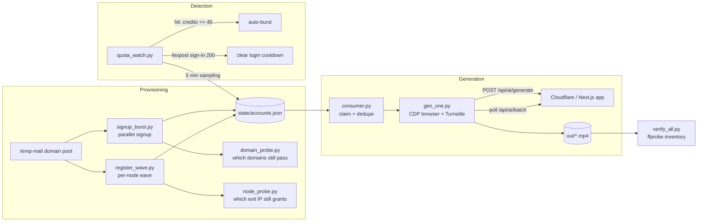

# seedance25-farm

> Reverse-engineered toolkit and unattended pipeline for **Seedance 2.5** (seedance2-5.com):
> account provisioning ? credential pool ? free-quota detection ? headless generation ?
> ffprobe-verified media library.

[????](README.zh-CN.md)

---

## 1. What this is

This repository is the working artefact of a full protocol reverse-engineering pass over the
Seedance 2.5 web app, plus the automation built on top of it.

It answers three questions with measured evidence, not vendor marketing:

| Question | Answer | Evidence |
|---|---|---|
| Is the advertised 1080p real, or upscaled? | **Real.** Server-side HEVC 1920?1080, 24 fps | 74 of 87 files carry `encoder=Lavf58.76.100` (CDN transcode); the other 13 carry the *local* `Lavf63.1.102` and are our own concatenations |
| What is the longest single generation? | **30 s** | task `da302264-a55f-472b-b3e6-baecf718a144` ? one URL, one file, 1920?1080 / 24 fps / 721 frames / 30.08 s / HEVC+AAC / 53.4 MB |
| Are the 12/16/24 s clips assembled? | **Yes.** Segments are `extend`-ed, then concatenated locally | the 24 s asset is `native_24s` + `native_30s_seg`; 721 frames = 24 s + 6 s |

The automation around it does: register accounts on disposable-mail domains, verify the mail,
store the session cookie, detect when the platform's free-credit gate is open, drive the studio
through a real browser (Cloudflare Turnstile included), download the result and re-probe every
file with `ffprobe`.

---

## 2. Architecture



Two execution modes coexist:

* **Browser mode** (`gen_one.py`) ? connects over CDP to a real Chrome, injects the account
  cookies, waits for the Turnstile token, submits through the page `fetch`, polls and downloads.
  This is the only mode that survives Turnstile.
* **REST mode** (`direct30.py`) ? plain HTTP for endpoints that do not sit behind Turnstile
  (used on the secondary site and for account/credit queries).

---

## 3. Repository layout

```
seedance25-farm/
??? README.md                 English (this file)
??? README.zh-CN.md           Chinese
??? requirements.txt
??? .env.example
??? docs/
?   ??? PROTOCOL.md           endpoints, request/response shapes, parameter tables
?   ??? FINDINGS.md           every measured claim + how it was measured
?   ??? PITFALLS.md           engineering traps (PowerShell, Clash, ffmpeg, ?)
??? src/
?   ??? gen_one.py            one clip end-to-end (CDP + Turnstile + poll + download)
?   ??? consumer.py           queue worker: claim account, generate, ledger, dedupe
?   ??? register_wave.py      wave registration over Clash nodes (signup?verify?signin)
?   ??? signup_burst.py       parallel signup through a single fixed exit
?   ??? quota_watch.py        5-min sampler + auto-burst when the gate opens
?   ??? domain_probe.py       full signup?verify?signin probe per mail domain
?   ??? node_probe.py         one signup per idle exit IP, records the grant
?   ??? verify_all.py         ffprobe inventory of the media library
?   ??? direct30.py           REST path (secondary site, 1080p/30 s)
??? scripts/
?   ??? consumer_a.ps1 ? consumer_e.ps1   supervisor loops (one CDP endpoint each)
?   ??? wave_run.ps1          scheduled registration wave
?   ??? burst_run.ps1         repeated parallel-signup bursts
?   ??? watch_run.ps1         quota watcher supervisor
??? state/                    runtime state (gitignored)
??? out/                      media output (gitignored)
```

---

## 4. Quick start

### 4.1 Prerequisites

* Windows 10/11 (the supervisors are PowerShell; the Python is portable)
* Python 3.11+
* Chrome/Chromium started with a CDP port, e.g.
  `chrome.exe --remote-debugging-port=9222 --user-data-dir=%TEMP%\sd25prof`
* `ffmpeg` / `ffprobe` on `PATH`
* A proxy pool you are allowed to use (Clash is assumed, see 4.3)

### 4.2 Install

```bash
python -m venv .venv
.venv\Scripts\activate
pip install -r requirements.txt
copy .env.example .env
```

### 4.3 Configuration

| Variable | Default | Meaning |
|---|---|---|
| `S25_OUT` | `<repo>/out` | where mp4 files land |
| `S25_STATE_DIR` | `<repo>/state` | account pool, ledgers, claims, pending |
| `S25_CDP` | `http://127.0.0.1:9222` | CDP endpoint of the browser that owns `cf_clearance` |
| `S25_PROXY` | `http://127.0.0.1:7897` | HTTP proxy for REST calls |
| `S25_FRESH_PROXY` | `http://127.0.0.1:8893` | fixed, clean exit used by the burst sampler |
| `S25_CLASH_API` | `http://127.0.0.1:9097` | Clash external controller |
| `CLASH_SECRET` | *(empty)* | Clash `secret` |
| `S25_DOMAIN` | `mailto.plus,fexbox.org,fextemp.com,any.pink` | disposable-mail domains, rotated per signup |
| `S25_RES` / `S25_WM` | *(unset)* | force a resolution button / try to disable the watermark |
| `S25_RELOGIN` | `1` | refresh the session cookie by REST sign-in before each clip |
| `S25_LOGIN_COOLDOWN` | `1200` | seconds to stay quiet after a `500` sign-in |

### 4.4 Run one clip

```bash
# state/one.json must hold one account record (see docs/PROTOCOL.md ?5)
python src/gen_one.py state/one.json "A slow aerial push over a glacier at dawn" demo01
```

### 4.5 Run the queue

```powershell
powershell -ExecutionPolicy Bypass -File scripts\consumer_a.ps1
```

Each supervisor restarts its worker after 20 s, so a crash never stops the line.

### 4.6 Detect the gate and burst

```powershell
powershell -ExecutionPolicy Bypass -File scripts\watch_run.ps1
```

`quota_watch.py` samples one verified signup every 5 minutes. On `credits == 40` it switches to
burst mode (up to 20 additional signups, stopping after 3 consecutive zeros) and writes every
hit into `state/accounts.json`, where the consumers pick it up automatically.

---

## 5. Script reference

| Script | Inputs | Output | Notes |
|---|---|---|---|
| `gen_one.py` | account json, prompt, tag | `out/<tag>_<batch8>_<res>_<dur>s.mp4` | Clears auth cookies only, keeps `cf_clearance`/`__cf_bm`, waits for `[name=cf-turnstile-response]`, submits, polls `/api/ai/batch` |
| `consumer.py` | `SPLIT_MOD`/`SPLIT_REM` sharding | ledger + claims json | Skips accounts already in any ledger; retries twice per account |
| `register_wave.py` | Clash node list, `PER`, `MIN_AGE` | accounts appended to state | Per node: signup ? send verification ? read inbox ? click ? signin ? credits |
| `signup_burst.py` | `THREADS`, `CAP`, `GAP` | accounts appended to state | Single fixed exit, parallel; stops after N consecutive zeros |
| `quota_watch.py` | ? | `grantwatch2.jsonl` | Samples, re-checks old zero-credit accounts, probes blocked domains |
| `domain_probe.py` | domain list | `domainprobe.json` | Full signup?verify?signin per domain, records exact status codes |
| `node_probe.py` | `N` | `nodecredit.json` | One signup per idle exit IP |
| `verify_all.py` | dirs | `state/verify_summary.json` | Resolution histogram, suspicious files, duplicate batch prefixes |

---

## 6. Protocol cheat-sheet

Full detail in [docs/PROTOCOL.md](docs/PROTOCOL.md); the essentials:

| Endpoint | Method | Purpose |
|---|---|---|
| `/api/auth/sign-up/email` | POST | `{email,password,name}` ? 200 + user (no session until verified) |
| `/api/auth/send-verification-email` | POST | `{email,callbackURL}` ? 200 |
| `/api/auth/verify-email?token=?` | GET | marks `emailVerified=true` |
| `/api/auth/sign-in/email` | POST | `{email,password}` ? 200 + `__Secure-better-auth.session_token` |
| `/api/user/get-user-credits` | POST | `{}` ? `{data:{remainingCredits}}` |
| `/api/user/get-user-info` | POST | plan flags: `hasActiveSubscription`, `hasPaidGenerationAccess`, ? |
| `/api/config/get-configs` | POST | feature flags (`email_verification_enabled`, ads labels, payment provider) |
| `/api/ai/generate` | POST | the actual job (requires `turnstileToken`) |
| `/api/ai/batch` | POST | `{batchId}` ? task list + `taskInfo.videos[0].videoUrl` |

Model / resolution / duration, read out of the front-end bundle and confirmed by real jobs:

| Model id | Resolutions | Duration |
|---|---|---|
| `seedance-2.5` | 480p / 720p / 1080p | 4?30 s |
| `seedance-2.5-lite` | 720p / 1080p | 4?30 s |

1080p pricing measured from balance deltas: **4 s = 130**, **8 s = 260**, **20 s = 651**,
**30 s = 976** credits (? 32.5 credits/s).

---

## 7. Measured results

* **30 s direct output** ? one task ? one URL ? one file:
  `1920?1080`, `24 fps`, `721 frames`, `30.08 s`, `HEVC + AAC`, `encoder=Lavf58.76.100`, `53.4 MB`,
  cost `976` credits (balance `1090 ? 114`).
* **No upscaling** ? of 87 files at 1920?1080, 74 are server-encoded (`Lavf58.76.100`);
  the 13 with `Lavf63.1.102` are our own ffmpeg 9.0.2 concatenations of native segments.
* **Free tier shape** ? 40 credits buys one 720p / 4 s job; the delivered file is
  `1344?768`, `4.48 s`, `24 fps`, `107 frames`.
* **Watermark** ? on a free account the `aria-label="Watermark"` switch cannot be turned off:
  clicking it leaves `aria-checked="true"`.
* **Free-credit window** ? observed grant rates: `108/111` (97%) at 03:05?05:11,
  `26/111` (23%) at 14:00, `0/8` at 16:35?16:41 across six idle exits **plus** a clean VPS,
  then `3/3` followed by `2/4` at 17:00 from the same VPS IP, then zero again.
  A fresh exit IP is necessary but not sufficient; the sampler is the only reliable trigger.

---

## 8. Known pitfalls

See [docs/PITFALLS.md](docs/PITFALLS.md) for the full list. The three that cost the most time:

1. **A disposable domain can be banned overnight.** `fexpost.com` moved from *working* to
   `422 FAILED_TO_CREATE_USER` on signup and `500` (empty body) on sign-in for existing accounts.
   Uppercasing the domain does **not** bypass it. Always keep a domain probe in the loop.
2. **Email verification became mandatory.** Unverified sign-in returns
   `403 EMAIL_NOT_VERIFIED`; the account has no session and therefore no credits.
3. **PowerShell `-Include` without a wildcard `-Path` silently returns the entire tree.**
   One such command moved 35,404 files (8.07 GB) in a single pass. Always use
   `-Filter *.mp4` or `Where-Object Extension -eq '.mp4'`.

---

## 9. Legal / ethical notice

This code exists to document and study how a commercial generative-video service behaves
(parameter limits, billing, anti-abuse controls). Running it against a service you do not own
may violate that service's Terms of Service and local law, and the free-credit machinery is
explicitly designed to obtain paid capacity for free. **Do not deploy it against production
systems without written authorization.** The authors publish it for research, interoperability
and defensive study; you are responsible for what you run.

No credentials, cookies, session tokens or account lists are included in this repository.
