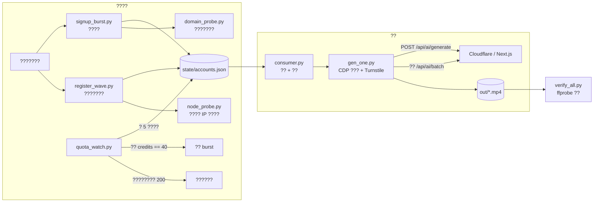

# seedance25-farm

> ?? **Seedance 2.5**?seedance2-5.com??????????????????
> ???? ? ??? ? ?????? ? ??????? ? ffprobe ???????

[English](README.md)

---

## ?????????

????????????????????????????????????????????????????????????

| ?? | ?? | ?? |
|---|---|---|
| ?? 1080p ???????? | **??**???? HEVC 1920?1080 / 24fps | 87 ? 1080p ??? 74 ? `encoder=Lavf58.76.100`?CDN ?????? 13 ? `Lavf63.1.102` ??? ffmpeg ???? |
| ?????????? | **30 ?** | ?? `da302264-a55f-472b-b3e6-baecf718a144`?????? URL?????1920?1080 / 24fps / 721 ? / 30.08s / HEVC+AAC / 53.4MB |
| 12/16/24 ??????? | **?? extend + ?? concat** | 24s ??? `native_24s` ? `native_30s_seg` ???721 ? = 24s + 6s |

????????????????????????????? cookie ??????????????????? Cloudflare Turnstile?????????? `ffprobe` ?????

---

## ????



?????????

* **?????**?`gen_one.py`??? ?? CDP ???? Chrome????? cookie?? Turnstile token??????? `fetch` ?????????????????? Turnstile ????
* **REST ??**?`direct30.py`??? ? HTTP?????? Turnstile ?????????????????

---

## ??????

```
seedance25-farm/
??? README.md                 ??
??? README.zh-CN.md           ???????
??? requirements.txt
??? .env.example
??? docs/
?   ??? PROTOCOL.md           ???????/????????
?   ??? FINDINGS.md           ???? + ????
?   ??? PITFALLS.md           ???????PowerShell / Clash / ffmpeg?
??? src/
?   ??? gen_one.py            ????????CDP + Turnstile + ?? + ???
?   ??? consumer.py           ?????????????????
?   ??? register_wave.py      ? Clash ?????????????????????
?   ??? signup_burst.py       ?????????
?   ??? quota_watch.py        5 ???? + ???? burst
?   ??? domain_probe.py       ???????????
?   ??? node_probe.py         ?????? IP ?????
?   ??? verify_all.py         ??? ffprobe ??
?   ??? direct30.py           REST ????????1080p/30s?
??? scripts/
?   ??? consumer_a.ps1 ? consumer_e.ps1   ?????????? CDP ???
?   ??? wave_run.ps1          ??????
?   ??? burst_run.ps1         ??????
?   ??? watch_run.ps1         ???????
??? state/                    ?????? gitignore?
??? out/                      ?????? gitignore?
```

---

## ??????

### 4.1 ??

* Windows 10/11?????? PowerShell?Python ????????
* Python 3.11+
* ? CDP ??? Chrome/Chromium???
  `chrome.exe --remote-debugging-port=9222 --user-data-dir=%TEMP%\sd25prof`
* `ffmpeg` / `ffprobe` ? `PATH` ?
* ????????????? Clash ???? 4.3?

### 4.2 ??

```bash
python -m venv .venv
.venv\Scripts\activate
pip install -r requirements.txt
copy .env.example .env
```

### 4.3 ???

| ?? | ??? | ?? |
|---|---|---|
| `S25_OUT` | `<repo>/out` | ???? |
| `S25_STATE_DIR` | `<repo>/state` | ????ledger?claims?pending |
| `S25_CDP` | `http://127.0.0.1:9222` | ?? `cf_clearance` ???? CDP ?? |
| `S25_PROXY` | `http://127.0.0.1:7897` | REST ???? HTTP ?? |
| `S25_FRESH_PROXY` | `http://127.0.0.1:8893` | ?????????? |
| `S25_CLASH_API` | `http://127.0.0.1:9097` | Clash ?????? |
| `CLASH_SECRET` | ? | Clash `secret` |
| `S25_DOMAIN` | `mailto.plus,fexbox.org,fextemp.com,any.pink` | ???????????? |
| `S25_RES` / `S25_WM` | ??? | ?????? / ????? |
| `S25_RELOGIN` | `1` | ????? REST ???? cookie |
| `S25_LOGIN_COOLDOWN` | `1200` | ???? 500 ?????? |

### 4.4 ???

```bash
# state/one.json ???????????? docs/PROTOCOL.md ?5?
python src/gen_one.py state/one.json "A slow aerial push over a glacier at dawn" demo01
```

### 4.5 ???

```powershell
powershell -ExecutionPolicy Bypass -File scripts\consumer_a.ps1
```

??????? worker ??? 20 ?????????????

### 4.6 ??????? burst

```powershell
powershell -ExecutionPolicy Bypass -File scripts\watch_run.ps1
```

`quota_watch.py` ? 5 ????????????????? `credits == 40` ??? burst
??????? 20 ???? 3 ? 0 ???????????? `state/accounts.json`?????????

---

## ??????

| ?? | ?? | ?? | ?? |
|---|---|---|---|
| `gen_one.py` | ?? json?????tag | `out/<tag>_<batch8>_<res>_<dur>s.mp4` | ???? cookie??? `cf_clearance`/`__cf_bm`?? `[name=cf-turnstile-response]`?????? `/api/ai/batch` |
| `consumer.py` | `SPLIT_MOD`/`SPLIT_REM` ?? | ledger + claims | ???? ledger ?????????????? 2 ? |
| `register_wave.py` | Clash ???`PER`?`MIN_AGE` | ?? state | ?????? ? ???? ? ??? ? ??? ? ?? ? ??? |
| `signup_burst.py` | `THREADS`?`CAP`?`GAP` | ?? state | ?????????? N ? 0 ??? |
| `quota_watch.py` | ? | `grantwatch2.jsonl` | ?? + ?????? + ?????? |
| `domain_probe.py` | ???? | `domainprobe.json` | ?????????????? |
| `node_probe.py` | `N` | `nodecredit.json` | ?????? IP ???? |
| `verify_all.py` | ?? | `state/verify_summary.json` | ?????????????? batch ?? |

---

## ??????

???? [docs/PROTOCOL.md](docs/PROTOCOL.md)??????

| ?? | ?? | ?? |
|---|---|---|
| `/api/auth/sign-up/email` | POST | `{email,password,name}` ? 200 + user????????? |
| `/api/auth/send-verification-email` | POST | `{email,callbackURL}` ? 200 |
| `/api/auth/verify-email?token=?` | GET | ? `emailVerified=true` |
| `/api/auth/sign-in/email` | POST | `{email,password}` ? 200 + `__Secure-better-auth.session_token` |
| `/api/user/get-user-credits` | POST | `{}` ? `{data:{remainingCredits}}` |
| `/api/user/get-user-info` | POST | ?????`hasActiveSubscription`?`hasPaidGenerationAccess` ? |
| `/api/config/get-configs` | POST | ?????`email_verification_enabled`??????????? |
| `/api/ai/generate` | POST | ??????? `turnstileToken`? |
| `/api/ai/batch` | POST | `{batchId}` ? ???? + `taskInfo.videos[0].videoUrl` |

?? / ??? / ?????? bundle ?????????????

| ?? id | ??? | ?? |
|---|---|---|
| `seedance-2.5` | 480p / 720p / 1080p | 4?30 s |
| `seedance-2.5-lite` | 720p / 1080p | 4?30 s |

1080p ??????????**4s = 130**?**8s = 260**?**20s = 651**?**30s = 976**?? 32.5 ?/???

---

## ??????

* **30 ???**???? ? ? URL ? ????`1920?1080`?`24fps`?`721 ?`?`30.08s`?
  `HEVC + AAC`?`encoder=Lavf58.76.100`?`53.4MB`?? `976` ???? `1090 ? 114`??
* **????**?87 ? 1920?1080 ??? 74 ????????`Lavf58.76.100`??
  13 ? `Lavf63.1.102` ????? ffmpeg 9.0.2 ?????????
* **?????**?40 ? = ?? 720p/4s????? `1344?768`?`4.48s`?`24fps`?`107 ?`?
* **??**????? `aria-label="Watermark"` ???????? `aria-checked` ?? `true`?
* **??????**?????? `108/111`?97%?03:05?05:11??`26/111`?23%?14:00??
  `0/8`?16:35?16:41??????? + ???? VPS???? 17:00 ?? VPS ? `3/3` ? `2/4`???????
  ????? IP ???????????????????????

---

## ??????

????? [docs/PITFALLS.md](docs/PITFALLS.md)???????

1. **??????????????** `fexpost.com` ???????? `422 FAILED_TO_CREATE_USER`?
   ????? `500`????????????**??**???????????????????
2. **?????????** ??????? `403 EMAIL_NOT_VERIFIED`???????????????
3. **PowerShell ? `-Include` ???? `-Path` ?????????** ????????????
   35,404 ????8.07GB????? `-Filter *.mp4` ? `Where-Object Extension -eq '.mp4'`?

---

## ??????

??????????????????????????????????????
???????????????????????????????????????????
??????????????**??????????????????** ??????
????????????????????????????

???**??**?????cookie??? token ??????
